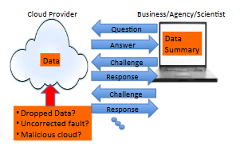

**图 1.1**： 用于检查云计算提供商是否正确存储和处理用户数据的交互式证明（Interactive Proof）或论证（Argument）的示意图。

## 1.2.1 交互式证明（Interactive Proofs, IPs）

要理解什么是交互式证明，不妨设想下面这个应用场景。假设一家企业（**验证者 verifier**）正在使用商业云计算服务商来存储和处理自己的数据。企业把全部数据上传给云端（**证明者 prover**）存储，而企业自己只保存一份极小的、关于数据的“秘密摘要”（这意味着云端并不知道用户的这份秘密摘要）。随后，企业向云端提出一个关于这些数据的查询问题——通常是以计算机程序 $f$ 的形式，要求云端利用其庞大的计算基础设施在数据上运行 $f$。云端执行计算后，将声称的程序输出 $f(\text{data})$ 发回给用户。企业不必盲目相信云端是否正确地在这批数据上执行了程序，而是可以使用**交互式证明系统（IP）**，从而获得关于该输出结果正确性的形式化保证。

在交互式证明中，企业会对云端进行“盘问/质询（interrogates）”：发送一连串**挑战（challenges）**，并接收一连串**响应（responses）**。质询结束后，企业必须决定接受（accept）**该答案为有效，还是**拒绝（reject）该答案为无效。这种交互的示意图可参见图 1.1。

IP 的**完备性（completeness）**意味着：如果云端在数据上正确运行了程序并严格遵循既定协议，那么用户就会被说服并接受该答案为有效。IP 的**可靠性（soundness）**意味着：如果云端返回了错误输出，那么无论云端如何竭力欺骗用户以使其接受该答案，用户都会以**高概率**将该答案作为无效结果拒绝。

从直觉上看，IP 的交互性（interactive nature）使企业能够利用“出其不意（element of surprise）”——即云端无法预测企业下一步会发出什么挑战——从而当场抓出说谎的云端。

值得一提的是，IP 与传统的**静态证明（static proofs）**之间存在一个颇具意味的差异。静态证明是**可转移的（transferrable）**：如果 Peggy（证明者）交给 Victor（验证者）一份证明某命题为真的证明，Victor 只需把这份证明复制一份，就能转过头去说服 Tammy（第三方）同一命题也为真。相比之下，交互式证明可能**不可转移（not be transferrable）**。Victor 可以试着把“自己与 Peggy 交互的记录（transcript）”发给 Tammy 来证明命题为真，但除非 Tammy 信任 Victor 如实记录了交互过程，否则 Tammy 不会被说服。这是因为 IP 的可靠性只有在“每一次 Peggy 向 Victor 发送响应时，Peggy 都不知道 Victor 接下来会用什么挑战来回应”的前提下才成立；而仅凭一份交互记录本身，无法向 Tammy 保证这一点。

