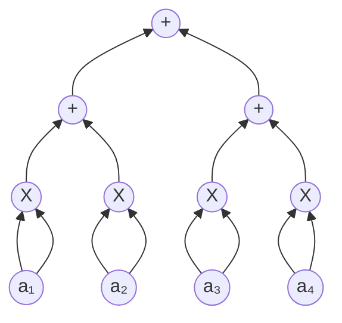
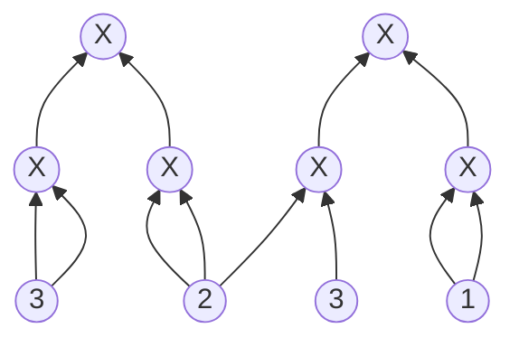

#### 第一层：图 4.8：GKR 协议的启动。

> 证明者 $P$：以给出一个答案（输出值）的形式开启对话。

#### 第二层：图 4.9：第 1 次迭代将一个关于 $C$ 输出的断言，归约为一个关于上一层门值的多线性扩展（MLE）的断言。

> $V$ 发送一系列挑战。$P$ 用关于下一层电路的信息进行回应。

#### 第三层：图 4.10：总的来说，第 $i$ 次迭代将一个关于第 $i$ 层门值多线性扩展的断言，归约为一个关于第 $i+1$ 层门值多线性扩展的断言。

> 挑战逐层向下持续推进，直至输入层。

#### 第四层：图 4.11：在最后一次迭代中，$P$ 对输入的 MLE 做出断言（在此，具有 $\mathbb{F}$ 中元素的长度为 $n$ 的输入被解释为一个映射 $\{0, 1\}^{\log_2 n} \to \mathbb{F}$ 的函数。根据事实 3.5，任何此类函数都有一个唯一的多线性扩展）。$V$ 可以在没有帮助的情况下检查这个断言，因为 $V$ 能够显式地看到输入。

> 最后，$P$ 说出了一些关于输入（的多线性扩展）的内容。

#### 图 4.12：示例电路 $C$ 及输入 $x$，以及 $C$ 各层 $i$ 对应的结果函数 $W_i$。注意，$C$ 有两个输出门。

> $W_0(0)=36,    W_0(1)=6$

> $W_1(0,0)=9,    W_1(0,1)=4,  W_1(1,0)=6,  W_1(1,1)=1$

> $W_2(0,0)=3,    W_2(0,1)=2,  W_2(1,0)=3,  W_2(1,1)=1$
