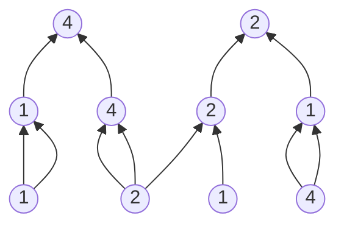

$$
\tilde{W}_0 = 4 + 3r
$$

<table style="border-collapse: collapse; text-align: center; margin: 0 auto;">
  <tr>
    <td style="border: 1px solid #888; padding: 4px 12px; background-color: #4a90e2; color: #fff;">4</td>
    <td style="border: 1px solid #888; padding: 4px 12px; background-color: #4a90e2; color: #fff;">2</td>
    <td style="border: 1px solid #888; padding: 4px 12px;">0</td>
    <td style="border: 1px solid #888; padding: 4px 12px;">3</td>
    <td style="border: 1px solid #888; padding: 4px 12px;">1</td>
  </tr>
</table>

$$
\tilde{W}_1(r_1,r_2) = (1-r_1)(1-r_2)+4(1-r_1)r_2+2r_1(1-r_2)+r_1r_2
$$

<table style="border-collapse: collapse; text-align: center; margin: 0 auto;">
  <tr>
    <td style="border: 1px solid #888; padding: 4px 8px; background-color: #4a90e2; color: #fff;">1</td>
    <td style="border: 1px solid #888; padding: 4px 8px; background-color: #4a90e2; color: #fff;">4</td>
    <td style="border: 1px solid #888; padding: 4px 8px;">2</td>
    <td style="border: 1px solid #888; padding: 4px 8px;">0</td>
    <td style="border: 1px solid #888; padding: 4px 8px;">3</td>
    <td style="border: 1px solid #888; padding: 4px 8px; background-color: #4a90e2; color: #fff;">2</td>
    <td style="border: 1px solid #888; padding: 4px 8px; background-color: #4a90e2; color: #fff;">1</td>
    <td style="border: 1px solid #888; padding: 4px 8px;">0</td>
    <td style="border: 1px solid #888; padding: 4px 8px;">4</td>
    <td style="border: 1px solid #888; padding: 4px 8px;">3</td>
    <td style="border: 1px solid #888; padding: 4px 8px;">3</td>
    <td style="border: 1px solid #888; padding: 4px 8px;">3</td>
    <td style="border: 1px solid #888; padding: 4px 8px;">3</td>
    <td style="border: 1px solid #888; padding: 4px 8px;">3</td>
    <td style="border: 1px solid #888; padding: 4px 8px;">3</td>
    <td style="border: 1px solid #888; padding: 4px 8px;">4</td>
    <td style="border: 1px solid #888; padding: 4px 8px;">0</td>
    <td style="border: 1px solid #888; padding: 4px 8px;">1</td>
    <td style="border: 1px solid #888; padding: 4px 8px;">2</td>
    <td style="border: 1px solid #888; padding: 4px 8px;">3</td>
    <td style="border: 1px solid #888; padding: 4px 8px;">0</td>
    <td style="border: 1px solid #888; padding: 4px 8px;">2</td>
    <td style="border: 1px solid #888; padding: 4px 8px;">4</td>
    <td style="border: 1px solid #888; padding: 4px 8px;">1</td>
    <td style="border: 1px solid #888; padding: 4px 8px;">3</td>
  </tr>
</table>

$$
\tilde{W}_2(r_1,r_2) = (1-r_1)(1-r_2)+2(1-r_1)r_2+r_1(1-r_2)+4r_1r_2
$$

<table style="border-collapse: collapse; text-align: center; margin: 0 auto;">
  <tr>
    <td style="border: 1px solid #888; padding: 4px 8px; background-color: #4a90e2; color: #fff;">1</td>
    <td style="border: 1px solid #888; padding: 4px 8px; background-color: #4a90e2; color: #fff;">2</td>
    <td style="border: 1px solid #888; padding: 4px 8px;">3</td>
    <td style="border: 1px solid #888; padding: 4px 8px;">4</td>
    <td style="border: 1px solid #888; padding: 4px 8px;">0</td>
    <td style="border: 1px solid #888; padding: 4px 8px; background-color: #4a90e2; color: #fff;">1</td>
    <td style="border: 1px solid #888; padding: 4px 8px; background-color: #4a90e2; color: #fff;">4</td>
    <td style="border: 1px solid #888; padding: 4px 8px;">2</td>
    <td style="border: 1px solid #888; padding: 4px 8px;">0</td>
    <td style="border: 1px solid #888; padding: 4px 8px;">3</td>
    <td style="border: 1px solid #888; padding: 4px 8px;">1</td>
    <td style="border: 1px solid #888; padding: 4px 8px;">1</td>
    <td style="border: 1px solid #888; padding: 4px 8px;">1</td>
    <td style="border: 1px solid #888; padding: 4px 8px;">1</td>
    <td style="border: 1px solid #888; padding: 4px 8px;">1</td>
    <td style="border: 1px solid #888; padding: 4px 8px;">1</td>
    <td style="border: 1px solid #888; padding: 4px 8px;">3</td>
    <td style="border: 1px solid #888; padding: 4px 8px;">0</td>
    <td style="border: 1px solid #888; padding: 4px 8px;">2</td>
    <td style="border: 1px solid #888; padding: 4px 8px;">4</td>
    <td style="border: 1px solid #888; padding: 4px 8px;">1</td>
    <td style="border: 1px solid #888; padding: 4px 8px;">0</td>
    <td style="border: 1px solid #888; padding: 4px 8px;">4</td>
    <td style="border: 1px solid #888; padding: 4px 8px;">3</td>
    <td style="border: 1px solid #888; padding: 4px 8px;">2</td>
  </tr>
</table>

---

图 4.14：在域 $\mathbb{F}_5$ 上的一个电路的描绘，该电路完全由乘法门组成；当该电路在长度为 4 的输入 $(1, 2, 1, 4)$ 上求值时，各层 $i$ 的多线性扩展编码 $\tilde{W}_i$（参见图 3.2）。由于有两个输出，$\tilde{W}_0$ 是一个单变量多项式，因此其求值表由 $\vert{}\mathbb{F}_5\vert{} = 5$ 个值组成。其他两层各有四个门，因此 $\tilde{W}_1$ 和 $\tilde{W}_2$ 是双变量多项式，其求值表各自包含 $5^2 = 25$ 个值，从 $(0,0)$ 到 $(4,4)$ 进行索引。由布尔向量索引的多线性扩展编码的条目被高亮显示为蓝色。在应用于该电路和该输入的 GKR 协议中，证明者首先发送两个输出门的声称值，从而指定了 $W_0$，接着验证者在一个随机点对 $\tilde{W}_0$ 求值。随后，在图 4.13 中 `for` 循环的每次迭代 $i$ 结束时，证明者被迫对 $\tilde{W}_i$ 的单个（随机选择的）求值做出声明。

**_方法 2_**：Cormode 等人 [CMT12] 改进了方法 1 的 $O(S^3)$ 运行时间。其观察结果与 4.4 节中的矩阵乘法协议类似：在求和检验协议的第 $j$ 轮中，$P$ 必须对 $f^{(i)}_{r_i}$ 进行求值的 $3 \cdot 2^{v-j}$ 个点具有高度的结构化特征，即它们的尾部条目（trailing entries）是布尔值。也就是说，$P$ 只需要对所有形式为 $z = (r_1, \dots, r_{j-1}, \{0,1,2\}, b_{j+1}, \dots, b_v)$ 的点 $z$ 求值 $f^{(i)}_{r_i}(z)$ 即可，其中 $v = 2k_i+1$ 且每个 $b_k \in \{0,1\}$。

对于每一个这样的点 $z$，求值 $f^{(i)}_{r_i}(z)$ 的瓶颈在于求值 $\tilde{\text{add}}_i(z)$ 和 $\tilde{\text{mult}}_i(z)$。直接应用引理 3.8 表明，每一次这样的求值都可以在 $2^v = O(S_i^2)$ 时间内完成。然而，我们可以通过观察发现函数 $\text{add}_i$ 和 $\text{mult}_i$ 是稀疏的：对于所有的布尔向量 $(a, b, c) \in \mathbb{F}^v$，除了形如 $(a, \text{in}_{1,i}(a), \text{in}_{2,i}(a))$ 的 $S_i$ 个向量之外，其余所有向量都有 $\text{add}_i(a,b,c) = \text{mult}_i(a,b,c) = 0$（其中 $a \in \{0,1\}^{k_i}$）。

因此，通过拉格朗日插值（引理 3.6），我们可以将 $\tilde{\text{add}}_i(z)$ 写为：

$$\tilde{\text{add}}_i(z) = \sum_{a \in \{0,1\}^{k_i}} \chi_{(a, \text{in}_{1,i}(a), \text{in}_{2,i}(a))}(z)$$

其中的求和仅遍历电路 $C$ 第 $i$ 层的加法门 $a$，对于 $\tilde{\text{mult}}_i(z)$ 也是如此（回想一下，多线性拉格朗日基多项式 $\chi_{(a, \text{in}_{1,i}(a), \text{in}_{2,i}(a))}$ 已在引理 3.6 的方程 (3.2) 中定义）。正如 4.4 节矩阵乘法协议中实现证明者的方法 2 的分析一样，对于任何形式为 $z = (r_1, \dots, r_{j-1}, \{0,1,2\}, b_{j+1}, \dots, b_v)$ 的输入 $z$，都有：

$$\chi_{(a, \text{in}_{1,i}(a), \text{in}_{2,i}(a))}(z) = 0$$

除非 $z$ 的最后 $v-j$ 个条目与 $(a, \text{in}_{1,i}(a), \text{in}_{2,i}(a))$ 的最后 $v-j$ 个条目相等（这里我们利用了 $z$ 的尾部条目是布尔值的性质）。因此，$P$ 只需要对电路 $C$ 第 $i$ 层的门进行单次遍历，就可以在求和检验协议的每一轮中对所有必要的点 $z$ 求值 $\tilde{\text{add}}_i(z)$：对于第 $i$ 层的每一个门 $a$，$P$ 仅需要针对那三个其尾部 $v-j$ 个条目与 $(a, \text{in}_{1,i}(a), \text{in}_{2,i}(a))$ 的尾部条目相等的点 $z$，更新 $\tilde{\text{add}}_i(z) \leftarrow \tilde{\text{add}}_i(z) + \chi_{(a, \text{in}_{1,i}(a), \text{in}_{2,i}(a))}(z)$ 即可。
