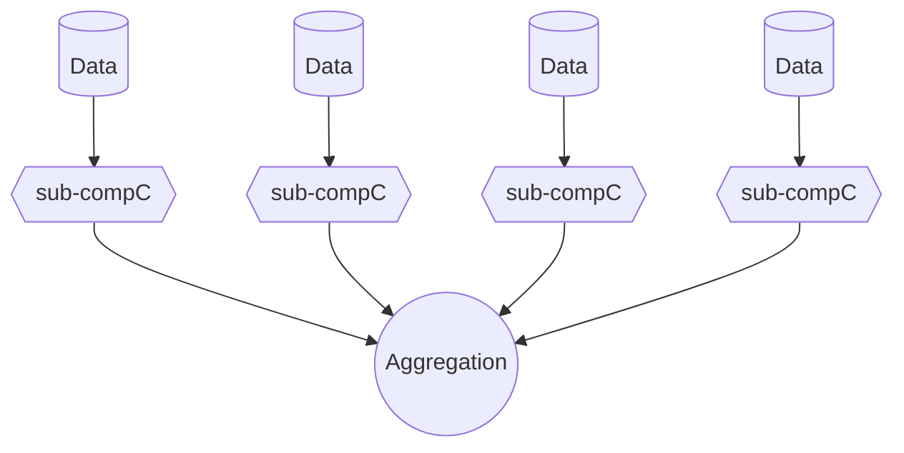

$$
图 4.15 —— 数据并行计算的示意图。
$$

**_协议及其成本_**。设 $C$ 是一个规模为 $S$、具有任意布线模式的电路，并设 $C'$ 是一个“超电路（super-circuit）”，它将 $C$ 独立应用于 $B = 2^b$ 个不同的输入，然后以某种方式对结果进行聚合。例如，在计数查询的情况下，聚合阶段简单地将数据并行阶段的结果相加。假设聚合步骤足够简单，其本身可以使用 4.6.5 节的技术进行验证。

如果对超电路 $C'$ 机械地套用 GKR 协议，验证者 $V$ 可能必须执行昂贵的预处理阶段，以便在必要的位置求出 $C'$ 的布线谓词 $\tilde{\text{add}}_i$ 和 $\tilde{\text{mult}}_i$——这需要 $\Omega(B \cdot S)$ 的时间。此外，当使用 [CMT12] 的技术将基础 GKR 协议应用于 $C'$ 时，证明者 $P$ 需要 $\Theta(B \cdot S \log(B \cdot S))$ 的时间。Vu 等人 [VSBW13] 采取了另一种方法，他们将 GKR 协议独立应用了 $B$ 次（电路的每个副本一次）。这导致通信成本和 $V$ 的在线检查时间都随子计算的数量 $B$ 线性增长，这是不可取的。

相比之下，本节的协议（由 [WJB+17] 提出，建立在 [Tha13] 的基础之上）兼具两者的优点：证明者和验证者的开销都与 $C$ 所应用的输入数量 $B$ 无关。更具体地说，验证者的预处理时间至多为 $O(S)$，与 $B$ 无关。证明者的运行时间为 $O(BS + S \log S)$。可以看出，只要 $B > \log S$（即计算中存在充足的数据并行性），就有 $O(BS + S \log S) = O(B \cdot S)$，因此证明者的速度仅比在没有任何正确性保证的情况下逐门计算电路的时间慢一个常数因子。

该协议的核心思想是：尽管每个子计算 $C$ 的布线模式可能很复杂，但在子计算之间，该电路是最大程度规则的，因为各个子计算之间完全没有交互。我们可以利用这种规律性来最小化验证者的预处理时间，并显著加速证明者。
