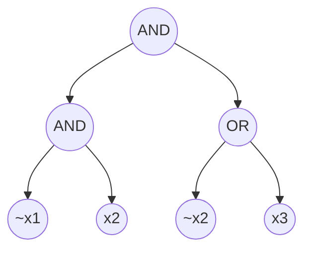

### 4.7 Exercises

**练习 4.1**。回想一下，4.3 节给出了一个用于计算三角形数量的双高效交互式证明（doubly-efficient interactive proof）。给定一个具有 $n$ 个顶点的图的邻接矩阵 $A$ 作为输入，该交互式证明将 $A$ 视为定义在域 $\{0,1\}^{\log_2 n} \times \{0,1\}^{\log_2 n}$ 上的函数，令 $\tilde{A}$ 表示其多线性扩展，并将求和检验协议（sum-check protocol）应用于 $(3 \log n)$ 元多项式：

$$g(X, Y, Z) = \tilde{A}(X, Y) \cdot \tilde{A}(Y, Z) \cdot \tilde{A}(X, Z)$$

图中的一个 4-环（4-cycle）是指一个由四个顶点构成的四元组 $(a, b, c, d)$，使得 $(a, b)$、$(b, c)$、$(c, d)$ 和 $(a, d)$ 全都是图中的边。请给出一个双高效交互式证明：给定一个简单图的邻接矩阵 $A$ 作为输入，计算该图中 4-环的数量。

$$
图 4.16：一个有 n = 3 个变量的布尔公式 \phi。
$$

## 解

### 一、 问题建模：如何用多项式表达 4-环？

设图的顶点数为 $n$，邻接矩阵为 $A$。矩阵 $A$ 的大小是 $n \times n$，其行和列的索引可以用 $\log_2 n$ 个比特来表示（假设 $n$ 是 2 的幂）。

- 如果顶点 $u$ 和 $v$ 之间有边，则 $A(u, v) = 1$；否则为 $0$。
- 邻接矩阵 $A$ 的多线性扩展（Multilinear Extension）记为 $\tilde{A}(X, Y)$。

#### 1. 4-环的数学定义

题目中指出，一个 4-环由四个顶点 $(a, b, c, d)$ 组成，满足以下四条边同时存在：

$$(a, b), \quad (b, c), \quad (c, d), \quad (d, a)$$

这意味着，我们需要在所有顶点的排列组合中，统计有多少个四元组 $(a, b, c, d)$ 使得：

$$A(a, b) \cdot A(b, c) \cdot A(c, d) \cdot A(d, a) = 1$$

#### 2. 构建目标求和多项式

为了用求和检验协议（Sum-check Protocol）来高效计数，我们需要构造一个多元多项式，使其在布尔超立方体上的求和正好等于 4-环的数量。

定义 $(4 \log n)$ 元多项式 $g(W, X, Y, Z)$：

$$g(W, X, Y, Z) = \tilde{A}(W, X) \cdot \tilde{A}(X, Y) \cdot \tilde{A}(Y, Z) \cdot \tilde{A}(Z, W)$$

其中 $W, X, Y, Z$ 每一个都是长度为 $\log_2 n$ 的布尔向量（对应顶点 $a, b, c, d$）。

#### 3. 注意重复计数与图的对称性

在简单的直接求和中：

- 每一个几何上的 4-环（比如环 $a-b-c-d-a$）会被顺时针、逆时针以及不同的起点多次遍历到。
- 通常在组合数论中，我们需要根据无向图的对称性（旋转和反转）对最终的求和结果除以相应的常数因子（对于无向简单图的 4-环，通常需要除以 8，具体取决于起点选择和方向）。但从**交互式证明的协议构造本身**来看，核心任务是利用求和检验协议来高效计算这个全域求和。

---

### 二、 证明协议的设计步骤

整个交互式证明分为两个主要阶段：**求和检验阶段（Sum-check Phase）** 与 **单点归约与验证阶段（Evaluation Phase）**。

#### Step 1: 运行求和检验协议（Sum-check Protocol）

1. 我们的目标是计算：

$$\text{Sum} = \sum_{W, X, Y, Z \in \{0,1\}^{\log_2 n}} \tilde{A}(W, X) \cdot \tilde{A}(X, Y) \cdot \tilde{A}(Y, Z) \cdot \tilde{A}(Z, W)$$

2. 这是一个包含 $4 \log n$ 个变量的求和问题。
3. 证明者 $P$ 和验证者 $V$ 运行 $4 \log n$ 轮的求和检验协议：

- 在每一轮中，$P$ 发送一个单变量低度多项式。
- $V$ 检查其边界条件并代入随机数。
- 经过 $4 \log n$ 轮后，协议将全域求和归约为在随机点 $(w, x, y, z) \in \mathbb{F}^{4 \log n}$ 处的求值声明：

$$\text{验证者需要检查：} \quad \tilde{A}(w, x) \cdot \tilde{A}(x, y) \cdot \tilde{A}(y, z) \cdot \tilde{A}(z, w) = v^*$$

（其中 $v^*$ 是求和检验最后一轮给出的期望值）。

#### Step 2: 归约到矩阵多项式 $\tilde{A}$ 的单点求值

1. 上一步中，验证者需要同时计算四个 $\tilde{A}$ 在不同随机点的值：$\tilde{A}(w, x)$、$\tilde{A}(x, y)$、$\tilde{A}(y, z)$ 和 $\tilde{A}(z, w)$。
2. 然而，这些点并不在同一个矩阵切片上。为了避免验证者自己去花 $O(n^2)$ 的时间计算 $\tilde{A}$，我们不能直接暴算。
3. **解决方法（类似 4.3 节的通用处理）**：
   我们可以再套用一次子协议，或者利用随机线性组合（Random Linear Combination）将这四个点合并，或者通过标准的 GKR/多线性扩展求值子协议，让证明者提供 $\tilde{A}$ 在这些随机点上的值，并证明其正确性。

- 在标准的图算法 IP 中（如教材 4.3 节处理三角形的套路），由于 $\tilde{A}$ 是由邻接矩阵直接通过多线性插值得到的，其在任意随机点 $r$ 处的求值可以通过对矩阵行/列的子集进行加权求和，在 **$O(n)$** 时间内由证明者协助完成，或者通过预处理/承诺机制完成。

---

### 三、 复杂度分析（为什么它是“双高效”的？）

1. **证明者时间（Prover Time）**：

- 每一轮求和检验需要对当前变量的所有可能取值进行插值和求和。
- 变量总数为 $4 \log n$，总项数为 $n^4$ 吗？**不需要！** 利用类似矩阵乘法或因子分解的优化技巧（逐个变量消元，每次只对关联的矩阵维度求和），证明者的总计算时间可以被控制在 **$O(n^2)$**（或与图中边数 $E$ 相关的多项式级别，远优于暴力枚举 $O(n^4)$）。

2. **验证者时间（Verifier Time）**：

- 验证者的主要工作是运行 $4 \log n$ 轮求和检验，每轮做几次域上的多项式运算。
- 总轮数是 $O(\log n)$，验证者的在线运行时间是 **$O(\log n)$**（多对数字的代数检查），实现了指数级的效率提升（Doubly-efficient）。
