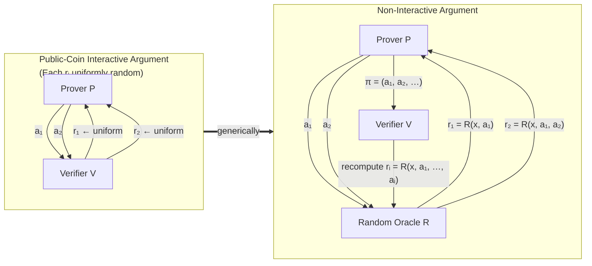

$$
图 5.1：Fiat–Shamir 变换的描绘。图片由 Ron Rothblum 提供 [Rot19]。
$$

请注意，只要允许 $g_1$ 的次数（degree）至少为 1，这样多项式就保证是存在的。
从 $\mathcal{I}$ 的那个点开始，作弊证明者 $P$ 可以发送与诚实证明者相同的消息，从而通过验证者的所有检查。在前面实现第二个方法的朴素尝试中，$Q$ 中的证明者将能够模拟对 $\mathcal{I}$ 的这种攻击。这是因为 $Q$ 中的证明者只需在输入 $1$ 处查询随机 oracle，就可以获知 $r_1$，然后选择 $g_1$ 以满足上面的式 (5.1)。

为了防止对可靠性（soundness）的这种攻击，Fiat-Shamir 变换确保了 $\mathcal{I}$ 的第 $i$ 轮中验证者的挑战 $r_i$，是通过在依赖于证明者第 $i$ 条消息 $g_i$ 的输入处查询随机 oracle 来确定的。这意味着，只有当证明者能够找到一个满足式 (5.1) 的 $g_1$（此时 $r_1$ 等于在适当查询点处对随机 oracle 的求值，如前所述，该查询点包含 $g_1$）时，$Q$ 中的证明者才能模拟前述对 $\mathcal{I}$ 的攻击。直观地说，对于 $Q$ 中的证明者来说，要找到这样一个 $g_1$ 需要对随机 oracle 进行大量的查询，因为随机 oracle 的输出是完全随机的，而且对于每个 $g_1$ 来说，满足式 (5.1) 的 $r_1$ 取值数量极少。

**_Fiat-Shamir 变换的完整描述_**。Fiat-Shamir 变换用以如下方式从随机 oracle 派生的值替换交互式协议 $\mathcal{I}$ 中的每一个验证者消息：在 $Q$ 中，$\mathcal{I}$ 的第 $i$ 轮中验证者的消息是通过查询随机 oracle 确定的，其中查询点是证明者在第 $1, \dots, i$ 轮中发送的消息列表。正如上面的朴素尝试一样，这消除了验证者向证明者发送任何信息的需要——证明者可以简单地发送包含整个协议通信记录（transcript）的单一消息（即，交互式协议中证明者交换的所有消息的列表，其中通信记录中验证者的随机抛硬币被刚刚描述的随机 oracle 求值所替代）。参见图 5.1。

**_一个具体的优化_**。当将 Fiat-Shamir 变换应用于多轮交互式协议时，它通常使用一种称为哈希链接（hash chaining）的技术来实现。这意味着，与其将交互式协议中的第 $i$ 轮验证者挑战 $r_i$ 选择为所有先前证明者消息 $g_1, \dots, g_i$ 的哈希（或随机 oracle 求值），不如选择 $r_i$ 仅作为 $(x, i, r_{i-1}, g_i)$ 的哈希。这在实践中降低了哈希的成本，因为它保持了计算哈希函数的输入较短。这种 Fiat-Shamir 的变体也可以在随机 oracle 模型中被证明是安全的。
