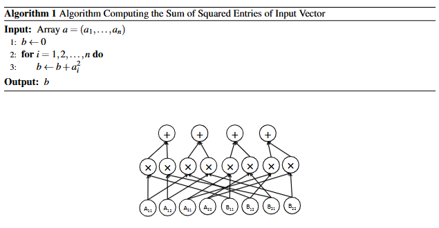

$$
图 6.1：一个实现 2 \times 2 矩阵朴素乘法算法的算术电路。
$$

虽然将朴素矩阵乘法算法转化为上述那样的算术电路相当直接，但执行诸如求值复杂条件语句等“非算术”操作的其他类型计算机程序，似乎很难被转化为小型算术电路。

在 6.3 节和 6.4 节中，我们将看到两种把任意计算机程序转化为电路的技术。在 6.5 节中，我们将看到第三种技术，它实用得多，但利用了有时被称为“非确定性电路”和“带辅助输入的电路”的概念。等价地讲，第三种技术产生的是电路可满足性问题（circuit satisfiability problem）的实例，而不是电路求值问题（circuit evaluation problem）的实例。

我们希望能够做出这样的论断：“任何在 $T$ 个时间步内停机的计算机程序，都可以被转化为一个深度较低、分层、入度为 2 且规模至多为 $O(T \log T)$ 的算术电路。”为了做出这种形式的论断，我们首先必须精确定义“一个计算机程序的运行时间为 $T$”到底意味着什么。
