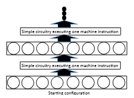

> 图 6.2：一种转换技术的概念示意图（_caricature_ 在此指直观的简化图解），该技术能将任何在时间 $T(n)$ 和空间 $s(n)$ 内运行的程序，转化为一个深度大致不超过 $T(n)$、宽度大致不超过 $s(n)$ 的电路。

使这种转换能够行之有效的关键点在于：可能的机器指令只有常数个，且每条指令都非常简单（仅以简单的方式操作常数个寄存器）。因此，将程序执行 $i$ 步之后的机器配置映射到第 $(i + 1)$ 步之后配置的电路非常简单。

不幸的是，这种转换所产生的电路大小为 $\tilde{\Theta}(T(n) \cdot s(n))$。这意味着，相对于运行计算机程序本身（耗时 $T(n)$），仅仅是写下或读取这个电路，其开销就要大出 $s(n)$ 倍。这种低效的根源在于：对于 RAM 的每一个时间步，电路都会产生一个全新的机器配置。每个配置的大小约为 $\tilde{\Theta}(s)$，因为配置必须指明该时间步下 RAM 内存的状态。从概念上讲，尽管程序的每个步骤在每个时间步中只修改常数个内存单元，但电路并不能“预先知道”哪些内存单元会被更新。因此，电路必须在每个时间步中，对每个内存单元显式地检查该内存单元是否应该被更新。这导致电路的规模至少比它所模拟的 RAM 的运行时间 $T(n)$ 大 $s(n)$ 倍。这种开销使得这种程序到电路的转换变得不切实际。

## 6.4 Turning Small-Space Programs Into Shallow Circuits(将小空间程序转化为浅电路)

从 6.3 节的程序到电路转换中生成的电路在 GKR 协议的语境下是毫无用处的，因为这些电路的深度至少为 $T$。当把 GKR 协议应用到这样一个深度极大的电路时，验证者的运行时间至少为 $T$。对于验证者来说，直接自己去运行计算机程序，而不去麻烦一个证明者，其速度其实是一样的。

第二种将计算机程序转化为电路的技术可以生成更浅的电路，前提是该计算机程序不需要占用太多的空间。具体而言，它能够把任何在时间 $T$ 和空间 $s$ 内运行的程序，转化为一个深度约为 $s \cdot \log T$、规模为 $2^{\Theta(s)}$ 的电路。

---

> 第二个问题是该电路非常深，即深度至少为 $T(n)$。由于 GKR 协议（第 4.6 节）的通信成本随电路深度线性增长，将 GKR 协议应用于该电路会导致通信成本至少为 $T(n)$，这是毫无意义的（因为在读取证明者消息所需的时间内，验证者本就可以自己运行 $M$）。这个问题将在下面的 6.4 节中得到解决，该节将电路深度降低到关于空间使用量（而不是 RAM 的运行时间）的多项式级别。然而，这带来的代价是：电路规模从 $\text{poly}(T,s)$ 增加到了 $2^{\Theta(s)}$。请注意，本手稿后续讨论的论证系统，其通信成本并不会随电路深度线性增长，因此将这些论证应用于本节所述的深电路确实会产生非平凡的协议。
