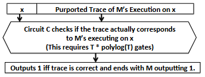

### 6.5.4 Details of the Transformation(转换的细节)

$$
图 6.3：从输入 x 上的 RAM 执行到电路可满足性实例的转换示意图
$$

电路 $C$ 将 $M$ 在 $x$ 上的整个执行过程的完整文本记录（transcript）作为非确定性输入，其中文本记录由（时间戳，列表）对组成，$M$ 执行的每一步对应一个这样的对。在此，列表指定了包含在当前程序计数器中的比特以及 $M$ 的所有寄存器的值。如果在 $M$ 执行的相应时间步发生了读或写操作，该列表还包括所访问的内存位置，以及如果是读操作则返回的值、或如果是写操作则写入内存的值。未发生读或写操作的时间步则包含一个特殊的内存地址以表明这一点。

随后，电路会检查该文本记录是否有效。有效性检查的细节如下。

从概念上讲，可以将运行时间为 $T$ 的随机存取机（RAM）视为由两个独立部分组成：

- **主内存的维护**：这意味着正确实现所有的内存读写。每次内存读取都应该返回写入该内存单元的最新值。
- **执行程序步骤**：假设内存维护正确，执行程序的 $T$ 个步骤。程序的每一步都很简单，因为它只影响机器的寄存器（寄存器数量是常数），并且对主内存至多执行一次读或写操作。

遵循上述对 RAM 操作的概念性划分，检查所声称的文本记录的有效性等同于检查它是否满足以下两个属性：

- **内存一致性（Memory consistency）**：每当从某个内存位置读取一个值时，检查文本记录声称返回的值是否等于写入该位置的最后一个值。
- **时间一致性（Time consistency）**：假设内存一致性检查成立，检查对于每个时间步 $i \in \{1, \dots, T-1\}$，机器在时间 $i+1$ 处的声称状态是否正确地由机器在时间 $i$ 处的声称状态推导得出。

电路通过将 RAM 的转移函数表示为一个小型子电路来检查时间一致性。我们在第 6.5.4.1 节中提供了该表示的一些细节。然后，它将该子电路应用于文本记录的每个条目 $i$，并检查其输出是否等于文本记录的条目 $i+1$。也就是说，对于 $1, \dots, T-1$ 中的每个时间步 $i$，电路都有一个输出门：当且仅当文本记录的条目 $i+1$ 等于将转移函数作用于条目 $i$ 的结果时，该输出门等于 0。

电路通过根据所读取或写入的内存位置对文本记录条目进行重新排序来检查内存一致性，若内存位置相同则按时间先后打破平局。也就是说，对于每个内存位置，该位置的读写操作按时间戳递增的顺序出现。我们将文本记录的这种重新排序称为内存排序（memory ordering）。不执行内存读或操作的文本记录条目可以按任意顺序组合并放在重新排序后的文本记录末尾——电路中检查内存一致性的部分将忽略这些条目。

给定经过内存排序的文本记录，电路可以非常直观地检查来自给定位置的每个内存读取是否返回了写入该位置的最后一个值。对于内存排序文本记录中的任意两个相邻条目，电路检查关联的内存位置是否相等，以及后一个条目是否包含读操作。如果是，它会检查读操作返回的值是否等于前一个操作中读取或写入的值。

排序步骤是 $C$ 的构建中最具概念参与度的一部分，将在第 6.5.4.2 节中讨论。请注意，至多 $T$ 个时间一致性检查和内存一致性检查中的所有内容都可以并行完成。正如我们将看到的，排序也可以在对数深度内完成。总之，这确保了 $C$ 具有多对数字符（polylogarithmic）的深度。
