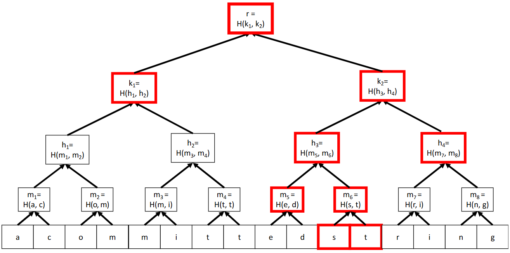

图 7.1：一棵使用哈希函数 $H$ 对字符串 “acommittedstring” 进行承诺的 Merkle 树。具有红色粗边框的方框表示用于揭示被承诺字符串的第十二个条目（即字母 t）的认证路径。这由从根节点到第十二个叶子节点路径上的每一个节点，以及每个此类节点的兄弟节点组成。

**_来自 Merkle 树的（放宽的）多项式承诺方案？_**
人们可能会尝试直接从 Merkle 树构造一个多项式承诺方案，具体做法如下：为了让证明者 $P$ 对一个多项式 $p$ 进行承诺，$P$ 可以对由多项式所有求值构成的字符串进行 Merkle 承诺，即 $p(\ell_1), \dots, p(\ell_N)$，其中 $\ell_1, \dots, \ell_N$ 是多项式所有可能输入的一个枚举。这将使证明者能够揭示多项式的任意请求求值：如果验证者询问 $p(\ell_i)$，证明者可以回复 $p(\ell_i)$ 以及该值的认证信息（认证信息由 $O(\log N)$ 个哈希值组成）。

不幸的是，这种方法并不能直接产生一个多项式承诺方案。原因在于，虽然 Merkle 树确实将证明者绑定到一个固定的字符串上，但它无法保证该字符串等于某个多线性多项式的全部求值。也就是说，当验证者 $V$ 要求 $P$ 揭示某个输入 $r$ 处的 $p(r)$ 时，Merkle 树的绑定性确实会迫使 $P$ 用已承诺字符串的第 $r$ 个条目以及相关的认证信息来响应。但是 $V$ 根本不知道被承诺的字符串是否由某个多线性多项式的全部求值组成——总的来说，被承诺的字符串可能由某个完全任意函数的全部求值组成。

为了解决这个问题，我们将 Merkle 树与低度检验（low-degree test）结合起来。低度检验不仅确保了证明者被绑定到某个（可能完全无结构的）字符串上，而且还确保了该字符串包含某个低度多项式的全部求值。更准确地说，它确保了该字符串“接近”于某个低度多项式的求值表，因此在这里使用它产生的是一个比实际的多项式承诺方案稍微弱一些的对象。尽管低度检验只检查字符串的一小部分条目（通常相对于字符串长度呈对数级），但它仍能保证这一点，从而使证明者传输的认证信息量保持在较低水平（至少比显式向验证者发送多项式的完整描述所需的通信量要低）。细节如下。
