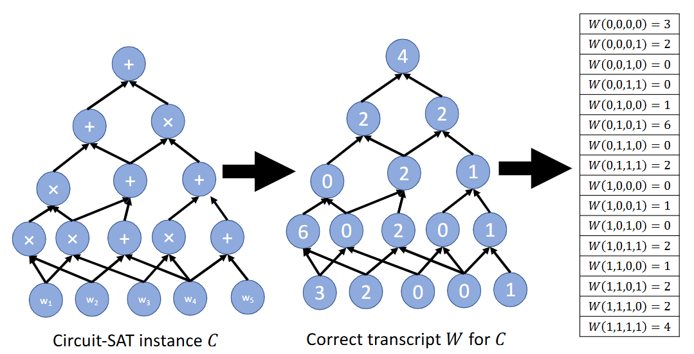

图 8.1：最左边的图描绘了一个定义在大小为 16 的有限域 $\mathbb{F}$ 上的算术电路 $C$，它没有公开输入 $x$，仅包含非确定性输入（见证）$w = (w_1, w_2, w_3, w_4, w_5) \in \mathbb{F}^5$。中间的图描绘了该电路产生输出 $y = 4$ 的一个正确执行记录（Transcript）$W$。最右边的图则是将 $W$ 视为一个映射函数 $\{0,1\}^4 \to \mathbb{F}$ 时的求值表（Evaluation Table）。

### 8.2.1 Protocol Summary(协议摘要)

### 8.2.1.1 Terminology(术语)

设 $C$ 是定义在有限域 $\mathbb{F}$ 上的算术电路，它接受显式输入（公开输入）$x$ 和非确定性输入（见证）$w$。

设 $S = 2^k$ 表示电路 $C$ 中的门（gates）总数，并为 $C$ 中的每个门分配一个长度为 $k$ 的二进制标签（来自 $\{0,1\}^k$）。我们将对 $C$ 中每个门赋予的值的整体赋值称为 $C$ 的**执行记录（Transcript）**，并把这个执行记录看作是一个映射函数 $W: \{0,1\}^k \to \mathbb{F}$，它将每个门的二进制标签映射为其具体计算出的值。

给定一个声称 $C(x,w) = y$ 的断言，一个正确的执行记录（Correct Transcript）必须满足以下条件：

1. 输入门被赋予的值与显式输入 $x$ 和见证 $w$ 相符；
2. 中间各个门的值严格对应于 $C$ 中每个门的正确运算逻辑（例如：如果是乘法门，其输出值必须等于两个输入值的乘积）；
3. 输出门被赋予的值等于最终结果 $y$。

因此，针对实例 $\{C, x, y\}$ 的**算术电路可满足性问题（Arithmetic Circuit Satisfiability）**，本质上就完全等价于：**判定是否存在这样一个合法的正确执行记录 $W$**。具体示例可参考前文的图 8.1。

### 8.2.1.2 Overview of the MIP(MIP 协议概述)

该 MIP 的工作原理是：让证明者 $P_1$ 声称自己“持有”一个针对实例 $\{C, x, y\}$ 的正确执行记录 $W$ 的扩展（extension）$Z$。如果证明者是诚实的，那么 $Z$ 就会等于 $\tilde{W}$（即 $W$ 的多重线性扩展）。接着，协议会构造出一个多项式 $g_{x,y,Z} : \mathbb{F}^{3k} \to \mathbb{F}$（它依赖于 $x$、$y$ 和 $Z$），该多项式满足以下关键性质：对于所有的布尔输入 $(a,b,c) \in \{0,1\}^{3k}$，都有 $g_{x,y,Z}(a,b,c) = 0$，**当且仅当** $Z$ 确实是某个正确执行记录 $W$ 的合法扩展。

为了检查 $g_{x,y,Z}$ 是否在所有的布尔输入上都为零（即是否“处处消逝”），协议会引入一个相关的多项式 $h_{x,y,Z}$，使得 “$g_{x,y,Z}$ 在所有布尔输入上都为零” 这一条件，等价于以下方程式的成立：

$$\sum_{(a,b,c) \in \{0,1\}^{3k}} h_{x,y,Z}(a,b,c) = 0 \quad \text{(式 8.1)}$$

严格来说，多项式 $h_{x,y,Z}$ 是通过随机化方法生成的。由于这种随机选择，存在一种极小的概率：即便 $g_{x,y,Z}$ 并没有在所有布尔输入上都为零，方程式 (8.1) 也有可能“碰巧”成立。为了计算这个总和，MIP 协议会直接对多项式 $h_{x,y,Z}$ 应用**求和检验协议（Sum-check Protocol）**。需要注意的是，如果 $Z$ 是一个低度多项式（low-degree polynomial），那么 $h_{x,y,Z}$ 也同样是低度多项式——这正是控制计算开销以及在求和检验协议中保证健全性（soundness）必不可少的条件。
