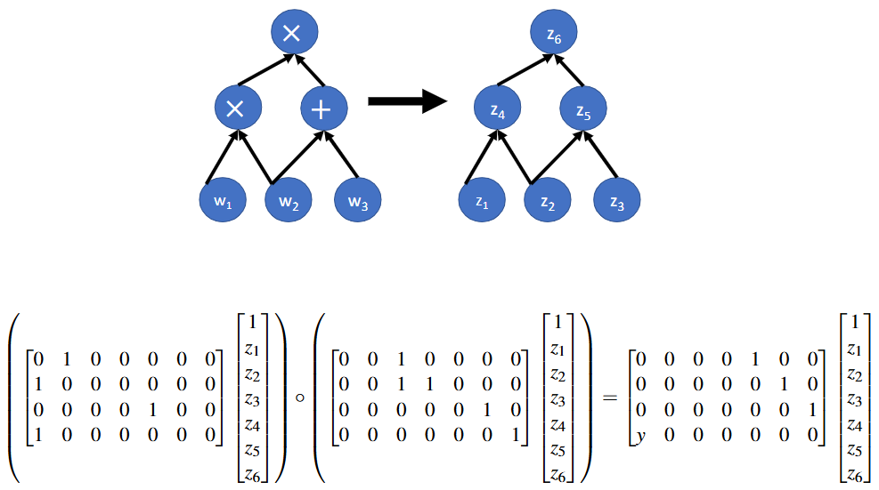

等价地，
$$
\begin{align*}
z_1 \cdot z_2 &= z_4 \\
1 \cdot (z_2 + z_3) &= z_5 \\
z_4 \cdot z_5 &= z_6 \\
1 \cdot z_6 &= y
\end{align*}
$$

图 8.2：一个算术电路和一个等价的 R1CS 实例。知道一个满足 $C(w) = y$ 的见证 $w$，等价于知道一个满足该 R1CS 约束的向量 $z$。该 R1CS 实例既以矩阵形式表达，为了提高可读性，也以约束列表的形式表达。