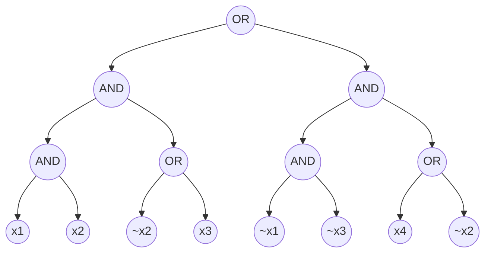
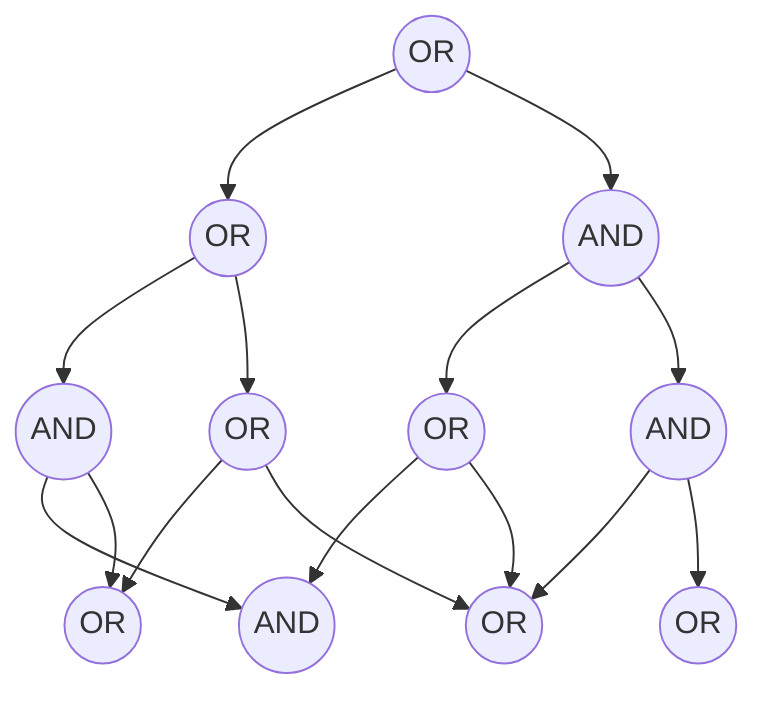

图 4.1：一个包含 4 个变量、规模为 8 的布尔公式 $\phi$。在此，$\lor$ 表示 OR（或），$\land$ 表示 AND（与），$\bar{x}_i$ 表示变量 $x_i$ 的否定。

图 4.2：一个基于 4 个输入变量的布尔电路。在此，$\lor$ 表示 OR（或），$\land$ 表示 AND（与），$\neg$ 表示否定。

人们普遍认为 #SAT 是一个非常困难的问题，已知最快的算法所需的时间关于变量数量 $n$ 呈指数级增长。这意味着，对于所有 $2^n$ 种可能的输入赋值，已知算法的效率并未比“暴力破解”方法好多少——即逐门（gate-by-gate）对公式求值，所需时间为 $O(S)$。甚至连判断该公式是否存在一个或多个满足解，人们也普遍认为需要指数级的时间。(45)尽管如此，针对 #SAT 仍然存在一个交互式证明协议，在这个协议中，验证者（verifier）可以在多项式时间内运行。

**_#SAT 的交互式证明协议_**。公式 (4.8) 对 $\phi$ 在 $\{0,1\}^n$ 中所有向量上的求值进行了求和。这与 Lund 等人 [LFKN92] 设计求和检验协议所要计算的函数形式非常相似——即针对某个低度多项式 $g$，计算其在 $\{0,1\}^n$ 上的求值之和。为了将求和检验协议应用于计算公式 (4.8)，我们需要在适当的有限域 $\mathbb{F}$ 上，确定一个总次数为 $\text{poly}(S)$ 的 $\phi$ 的多项式扩展 $g$。由于 $g$ 是 $\phi$ 的扩展，这将确保：

$$\sum_{x \in \{0,1\}^n} g(x) = \sum_{x \in \{0,1\}^n} \phi(x) \quad (4.6)$$

此外，我们需要验证者能够在一个随机点 $r$ 处，于多项式时间内对 $g$ 进行求值。结合 $g$ 的总次数为 $\text{poly}(S)$ 这一事实，这将确保应用于 $g$ 的求和检验协议中的验证者能在 $\text{poly}(S)$ 时间内运行。我们对 $g$ 的定义如下。

设 $\mathbb{F}$ 为一个大小至少为（比方说）$S^4$ 的有限域。在下文求和检验协议的应用中，可靠性误差（soundness error）至多为 $S/\vert{}\mathbb{F}\vert{}$，因此该域应当足够大，以确保此数值足够小。如果 $\vert{}\mathbb{F}\vert{} \approx S^4$，那么可靠性误差至多为 $1/S^3$。更大的域将确保更小的可靠性误差。

我们可以将 $\phi$ 转化为一个在 $\mathbb{F}$ 上的算术电路 $\psi$，该电路用于计算所需的 $\phi$ 的扩展多项式 $g$。在此，一个算术电路 $C$ 包含输入门、输出门、中间门，以及它们之间的有向连线。每个门计算有限域 $\mathbb{F}$ 上的加法或乘法。将布尔公式 $\phi$ 替换为计算 $\phi$ 的扩展多项式的算术电路 $\psi$ 的这一过程，被称为**算术化（Arithmetization）**。

---

> 45. 熟悉 NP 完全性（NP-completeness）概念的读者会认出，公式可满足性是一个 NP 完全问题，这意味着当且仅当 P = NP 时，它才拥有多项式时间算法。

> 46. 更准确地说，如果域 $\mathbb{F}$ 的大小为某个素数 $p$，那么 $\sum_{x\in\{0,1\}^n} g(x)$ 将等于 $\phi$ 的满足解数量对 $p$ 取模（modulo p）的结果。如果希望得到满足解的精确数量，有多种方法可以解决该问题。最简单的方法是选择一个大于可能满足解最大数量（即 $2^n$）的素数 $p$。由于这种大小的域中的元素可以用关于 $n$ 的多项式时间来表示和运算，因此这仍能保证验证者在多项式时间内运行。在设计那些基于有限域运行、但旨在表达整数算术的证明系统时，经常会出现类似的溢出问题。其他示例请参见脚注 54 以及第 6.5.4.1 节和第 6.6.3 节。
