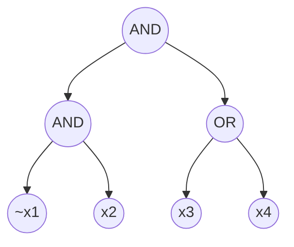
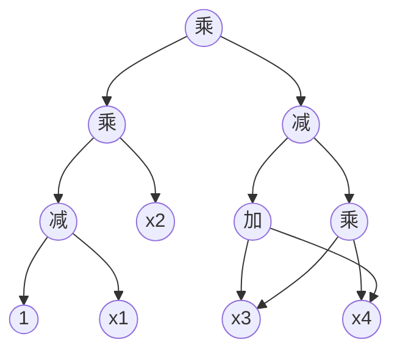

**图 4.3**：一个关于 4 个变量、规模为 4 的布尔公式 $\phi$。在此，$\vee$ 表示 OR（或），$\wedge$ 表示 AND（与），而 $\bar{x}_1$ 表示变量 $x_1$ 的否定。

**图 4.4**：一个算术电路 $\psi$，它在有限域 $\mathbb{F}$ 上计算 $\phi$ 的多项式扩展 $g$。

| 通信 (Communication) | 轮数 (Rounds) | 验证者时间 ($V_{\text{time}}$) | 证明者时间 ($P_{\text{time}}$) |
| :------------------- | :-----------: | :----------------------------- | :----------------------------- |
| $O(S)$ 个域元素      |      $n$      | $ O(S)$                        | $O(S^2 \cdot 2^n)$             |

**表 4.2**：当应用于规模为 $S$ 的布尔公式 $\phi: \{0,1\}^n \to \{0,1\}$ 时，第 4.2 节中 $\#SAT$ 协议的开销。

综合起来，(a) 和 (b) 表明了 $\text{IP} \subseteq \text{PSPACE}$，因为 $x \in L$ 当且仅当最优的证明者策略能使验证者以至少 $2/3$ 的概率接受输入 $x$。

性质 (b) 成立的原因很简单：对于任意固定的证明者策略 $P$ 和输入 $x$，在与 $P$ 交互时验证者接受的概率，可以通过枚举验证者随机硬币（random coins）的所有可能设置，并计算导致验证者接受的设置所占的比例，从而在 $O(n^c)$ 空间内计算出来。再次注意，这个枚举过程极其缓慢——需要随 $n$ 呈指数级增长的时间——但它只需要 $O(n^c)$ 的空间即可完成，因为如果验证者运行时间为 $O(n^c)$，那么它的空间使用量至多也就是 $O(n^c)$。关于性质 (a) 的证明，感兴趣的读者可参阅 [Koz06, Lecture 17]。

更具挑战性的方向是证明 $\text{PSPACE} \subseteq \text{IP}$。上文所述的 Lund 等人 [LFKN92] 的 $\#SAT$ 协议已经包含了证明这一点所必需的核心思想。Shamir [Sha92] 将 $\#SAT$ 协议推广到了 PSPACE 完全语言 TQBF（量化布尔公式），而 Shen [She92] 则给出了一个更简单的证明。我们在此不讨论 Shamir 或 Shen 对 $\#SAT$ 协议的推广，因为在后文（第 4.5.5 节）中，我们将提供一个不同且在数量级上更强的证明，来证明 $\text{PSPACE} \subseteq \text{IP}$。

## 4.3 Second Application: A Simple IP for Counting Triangles in Graphs(第二个应用：图(网络)中三角形计数的简单交互式证明)

第 4.2 节使用求和检验协议给出了针对 #SAT 问题的交互式证明，其中验证者的运行时间是输入规模的多项式，而证明者的运行时间则是输入规模的指数级。这看起来似乎并没有什么实际用处，因为在现实世界中，一个指数级时间的证明者根本无法扩展到哪怕中等规模的输入上。理想情况下，我们希望证明者运行在多项式时间（而不是指数级时间）内，并且我们希望验证者运行在线性时间（而不是多项式时间）内。达到这种时间开销的交互式证明通常被称为双重高效（doubly-efficient）交互式证明，选择这一术语是为了强调验证者和证明者都高度高效。本章的剩余部分将专注于开发双重高效的交互式证明。

---

正如 [Koz06, 第 17 讲] 中所述，$\text{IP} \subseteq \text{PSPACE}$ 这一结果可归功于 Goldwasser 和 Sipser [GS86] 的论文中所引用的 Paul Feldman 的一份未发表手稿，同时也遵循了 [GS86] 文中的分析。
