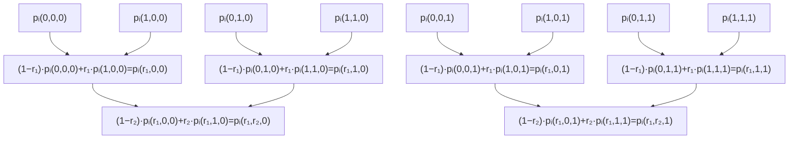

---

**图 4.6**：在 $\ell = 3$ 的情况下，引理 4.5 中专门用于多项式 $p_i$ 的诚实证明者内部数据结构的逐轮演进图解（回想一下，该引理考虑的是当每个 $p_i$ 均为多线性时，应用于计算 $\sum_{x \in \{0,1\}^\ell} p_1(x) \cdots p_k(x)$ 的求和检验协议）。顶层用于证明者计算其在第一轮中规定的消息，中层用于第二轮，底层用于第三轮。

| 通信 (Communication) | 轮数 (Rounds) | 验证者时间 ($V_{\text{time}}$) | 证明者时间 ($P_{\text{time}}$) |
| :------------------- | :-----------: | :----------------------------- | :----------------------------- |
| $O(logn)$ 个域元素   |    $logn$     | $ O(n^2)$                      | $T + O(n^2)$                   |

**表 4.3**：当应用于 $n \times n$ 的矩阵 $A$ 和 $B$ 时，第 4.4 节中 MATMULT 协议的开销。这里，$T$ 是证明者（P）计算乘积矩阵 $C = A \cdot B$ 所需的时间。

**_引理 4.5_**.（隐式包含于 [CTY11, 附录 B]，亦参见 [Tha13, XZZ+19]）设 $p_1, p_2, \dots, p_k$ 为 $\ell$ 元多线性多项式。假设对于每个 $p_i$，都存在一个算法，能在 $O(2^{\ell})$ 时间内计算出 $p_i$ 在 $\{0,1\}^{\ell}$ 所有输入上的值。设 $g = p_1 \cdot p_2 \cdot \dots \cdot p_k$ 为这些多线性多项式的乘积。那么当求和检验协议应用于多项式 $g$ 时，诚实证明者可以在 $O(k \cdot 2^{\ell})$ 时间内实现。

证明. 如公式 (4.12) 中所解释，在求和检验协议中，诚实证明者计算的主要开销在于计算引理 4.4 中所述形式的点上的 $g$（参见公式 (4.14)）。为了获得这些求值，显然只需在这些点中的每一个上计算 $p_1, \dots, p_k$，并以每个点 $O(k)$ 的时间将结果相乘。引理 4.4 保证了每个 $p_i$ 可以在 $O(2^{\ell})$ 时间内在相关点上进行求值，从而产生 $O(k \cdot 2^{\ell})$ 的总运行时间。关于 $\ell = 3$ 情况下诚实证明者计算的描绘，请参见图 4.6。

在本节的矩阵乘法协议中，求和检验协议被应用于 $(\log_2 n)$ 元多项式 $g(X_3) = \tilde{f}_A(r_1, X_3) \cdot \tilde{f}_B(X_3, r_2)$。多线性多项式 $\tilde{f}_A(r_1, X_3)$ 可以通过应用 $h = \tilde{f}_A$ 的引理 4.4，并观察到 $\tilde{f}_A(r_1, X_3)$ 的必要求值是公式 (4.14) 中点的一个子集（其中公式 (4.14) 中的 $i$ 等于 $\log n$，且公式 (4.14) 中的 $(r_1, \dots, r_{\log n})$ 等于 $r_1$ 的条目），从而在 $O(n^2)$ 时间内计算出 $\{0,1\}^{\log n}$ 中所有输入的求值。类似地，$\tilde{f}_B(X_3, r_2)$ 可以在 $O(n^2)$ 时间内计算出 $\{0,1\}^{\log n}$ 中所有输入的求值。给定所有这些求值，引理 4.5 意味着证明者仅需 $O(n)$ 的额外时间即可执行其在求和检验协议中的部分。

这完成了本节矩阵乘法协议中的证明者如何在总共 $O(n^2)$ 时间内执行其求和检验协议部分的解释。
