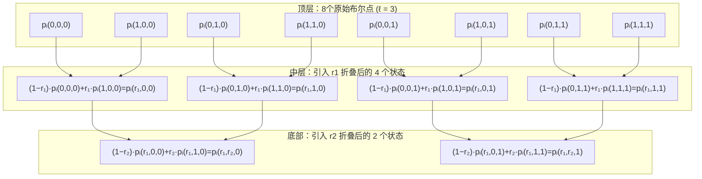

```mermaid

p_i(0,0,0)|p_i(0,0,1)|p_i(0,1,0)|p_i(0,1,1)|p_i(1,0,0)|p_i(1,0,1)|p_i(1,1,0)|p_i(1,1,1)


(1-r1)*p_i(0,0,0) + r1*p_i(1,0,0)= p_i(r1,0,0)

(1-r1)*p_i(0,0,1) + r1*p_i(1,0,1)= p_i(r1,0,1)

(1-r1)*p_i(0,1,0) + r1*p_i(1,1,0)= p_i(r1,1,0)

(1-r1)*p_i(0,1,1) + r1*p_i(1,1,1)= p_i(r1,1,1)


(1-r2)*p_i(r1,0,0) + r2*p_i(r1,1,0) = p_i(r1,r2,0)

(1-r2)*p_i(r1,0,1) + r2*p_i(r1,1,1) = p_i(r1,r2,1)

```
