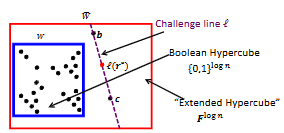

**图 4.7**：将关于 $\tilde{W}(b)$ 与 $\tilde{W}(c)$ 取值宣称的验证归约为对 $\tilde{W}(r)$ 取值的单一宣称的原理示意图。此处，$\tilde{W}$ 为 $W$ 的多线性扩展，$\ell$ 为穿过 $b$ 和 $c$ 的唯一直线，而 $r = \ell(r^*)$ 为直线 $\ell$ 上的一个随机点。

然后，$P$ 发送一个次数至多为 $2 \log n$ 的一元多项式 $q$，宣称其为 $\tilde{W} \circ \ell$。$V$ 将 $q(0)$、$q(1)$、$q(2)$ 解释为证明者关于 $\tilde{W}(a)$、$\tilde{W}(b)$ 和 $\tilde{W}(c)$ 取值的宣称。$V$ 挑选一个随机点 $r^* \in \mathbb{F}$，设置 $r = \ell(r^*)$，并将 $q(r^*)$ 解释为证明者关于 $\tilde{W}(r)$ 取值的宣称。

与将 $\tilde{W}$ 的两次求值归约为一次的协议相比，多项式 $q$ 的次数从 $\log n$ **翻倍到了 $2 \log n$**，因此从证明者到验证者的通信量大约增加了 **2 倍**，但依然维持在 $O(\log n)$。协议依然保持**完美完备性（Perfect Completeness）**，而可靠性误差（Soundness Error）从 $\frac{\log n}{\vert{}\mathbb{F}\vert{}}$ 增加到了 $\frac{2 \log n}{\vert{}\mathbb{F}\vert{}}$（即成功率从 $1 - \frac{\log n}{\vert{}\mathbb{F}\vert{}}$ 微降至 $1 - \frac{2 \log n}{\vert{}\mathbb{F}\vert{}}$）。

该协议可以应用在我们已介绍过的两种三角形计数协议的结尾处（此时 $\tilde{W}$ 等于 $\tilde{f}_A$），将 $V$ 需要评估 $\tilde{f}_A$ 的点数**从 3 个减少到 1 个**。由于这些求值是 $V$ 运行时间中的主要开销，这使得 **$V$ 的计算时间基本上缩减为了原来的 $\frac{1}{3}$（效率提升了约 3 倍）**。

在下一节的矩阵乘幂（Matrix Powering）协议中，该技术将被用来实现更显著的验证成本提升，并且它还将在第 4.6 节电路评估的 GKR 协议中反复出现。

### 4.5.3 A Super-Efficient IP for Matrix Powers(矩阵乘幂的超级高效交互式证明)

设 $A$ 是一个 $n \times n$ 的矩阵，其元素来自有限域 $\mathbb{F}$，并假设验证者想要评估一个大整数 $k$ 阶幂矩阵 $A^k$ 的单个元素。为了具体起见，我们假设 $V$ 关心的矩阵项是 $(A^k)_{n,n}$，且 $k$ 和 $n$ 都是 2 的幂。正如我们即将解释的那样，4.4 节的矩阵乘法 IP（MatMult IP）提供了一种完成此任务的方法，其轮数和通信量为 $O(\log(k) \cdot \log(n))$，验证者的运行时间为 $O(n^2 + \log(k)\log(n))$。

显然，我们可以将矩阵 $A^k$ 表示为较小幂次的乘积：

$$A^k = A^{k/2} \cdot A^{k/2} \quad \text{(方程 4.16)}$$

因此，设 $g_\ell$ 表示矩阵 $A^\ell$ 的多线性扩展，我们可以尝试利用方程 (4.16)，通过对矩阵应用 MatMult IP 来计算 $(A^k)_{n,n} = g_k(1,1)$。这里，$\mathbf{1} \in \{0,1\}^{\log n}$ 表示数字 $n-1$ 的二进制表示，因此 $(1,1)$ 用于表示索引右下角矩阵项的二进制字符串。

在对两个 $n \times n$ 矩阵 $A', B'$ 应用 MatMult IP 的末尾，验证者需要在 $\mathbb{F}^{\log n} \times \mathbb{F}^{\log n}$ 中的各自坐标点 $(r_1, r_2)$ 和 $(r_2, r_3)$ 处分别评估 $\tilde{f}_{A'}$ 和 $\tilde{f}_{B'}$。在上述 MatMult IP 的调用中，$A'$ 和 $B'$ 都等于 $A^{k/2}$。因此，在 MatMult IP 结束时，验证者必须在两个点 $(r_1, r_2)$ 和 $(r_2, r_3)$ 处评估多项式 $f_{A^{k/2}} = g_{k/2}$。不幸的是，**验证者无法做到这一点，因为她根本不知道矩阵 $A^{k/2}$ 是什么**。
